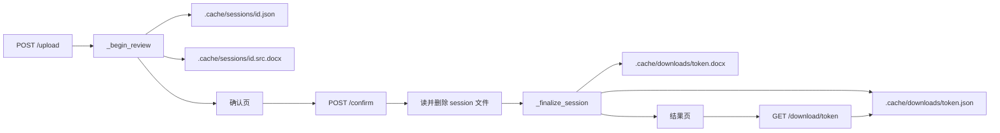

# 方案 E：磁盘会话/下载缓存（SECURITY 1.1 问题 1+2）

## 范围（已拍板）

- **做**：磁盘外置会话与下载元数据（无 Redis）；上传原文落盘；惰性清理逻辑迁到扫目录；文档同步；DEPLOY/HANDOFF 中 systemd 示例 `-w 2`。
- **不做（问题 3/4 后续）**：会话数/缓存总大小硬上限；定时清理任务；首次下载删除；TTL 仍保持 **3600 秒**（不改 30 分钟）。

## 现状锚点

- 内存字典与 TTL：`word_retrieval/routes.py` 中原 `_SESSIONS`、`_DOWNLOADS`、`_MAX_CACHE_AGE_SEC = 3600`、`_begin_review` / `_finalize_session` / `download_file`
- 配置：`word_retrieval/__init__.py` 的 `DOWNLOAD_DIR` → `.cache/downloads`；新增 `SESSION_DIR` → `.cache/sessions`
- `.cache/` 已在 `.gitignore`；deploy 已 exclude `.cache`

## 目标数据流



## 磁盘布局

```text
.cache/
  sessions/
    {session_id}.json      # 元数据（无大二进制）
    {session_id}.src.docx  # 可选；有上传 Word 时才有
  downloads/
    {token}.docx
    {token}.json           # created_at, download_name
```

会话 JSON 字段：`created_at`, `source_label`, `stem`, `wordlist_name`, `user_data`, `baseline_names`, `green`/`yellow`/`red`（list；读写时转 set）、`source_path`。

## 实现要点

### 1. `word_retrieval/job_cache.py`

- `save_session` / `load_session` / `pop_session` / `put_session`
- `store_download` / `get_download` / `delete_download`
- `cleanup_expired`：扫 sessions/downloads；含孤儿 `.src.docx` / `.docx`
- 写入：`*.tmp` + `os.replace`；无 Redis、无新依赖

### 2. `word_retrieval/__init__.py`

- `SESSION_DIR`；启动 `ensure_cache_dirs`

### 3. `word_retrieval/routes.py`

- 去掉模块级 `_SESSIONS` / `_DOWNLOADS`
- 原文落盘；确认失败 `put_session`；下载仍可重复（问题 4 不做）
- TTL 3600；惰性清理（问题 3 强清理不做）

### 4. 文档

- `README.md`、`HANDOFF.md`、`.github/DEPLOY.md`（`-w 2` 示例）、`SECURITY_STABILITY.md`、`privacy.py`、`README.docx`

## 明确不改

- 确认页勾选默认、着色/释义表两套逻辑、`user_data` 只回浏览器
- 设置页 JSON `\u003c` 规则
- 下载 TTL、首次下载删除、会话数/体积硬上限

## 验收

- 同一会话文件可被另一进程 `pop`（多 worker）
- 上传 docx → 确认 → 下载仍成功；确认失败可写回会话
- 过期惰性清理删 session/src/download
- 文档含 `-w 2` 与磁盘缓存说明

## 落地记录

- 日期：2026-10-28
- 状态：已按本计划实现
