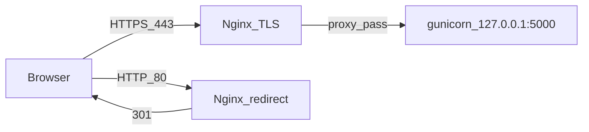

# SECURITY 1.2 后两项：HTTPS + 错误脱敏

## 范围

- **做**
  - HTTPS：`wordsorting.com` 上 Let's Encrypt 证书；安全组放行 `443`；Nginx 终结 TLS 并 HTTP→HTTPS 重定向；gunicorn 仍只听 `127.0.0.1:5000`。
  - 错误脱敏：改 `word_retrieval/routes.py`；业务 `ValueError` / `CacheLimitError` 文案可对外；意外异常与可能含路径的细节只写日志。
  - 文档：`HANDOFF.md`、`.github/DEPLOY.md`、`README.md`（中英相关段）、`SECURITY_STABILITY.md` 修订记录；隐私页一句「传输 HTTPS」。
- **不做**：`deploy.yml` 分支收紧；Flask 内终结 TLS；HSTS/CSP（属 2.3）；改确认页勾选/写回/`user_data` 边界。

## HTTPS（运维 + 文档）

### 拍板细节

- 证书：Ubuntu 上 `certbot --nginx -d wordsorting.com`（当前仅裸域）。
- Nginx：`listen 443 ssl`；`proxy_pass http://127.0.0.1:5000`；补 `X-Forwarded-Proto $scheme`；80 端口 `return 301 https://$host$request_uri`。
- 阿里云安全组：入方向 TCP `443/443` `0.0.0.0/0`；**仍不开放 5000**。
- 应用代码：现有 `url_for` 均为相对路径，**不改 Flask**。
- 仓库交付：`DEPLOY.md` 可复制 Nginx/certbot/安全组步骤；HANDOFF §4 与 README 同步。
- 执行方式：证书与 Nginx 在服务器上手动做一次（不进每次 Actions）。

## 错误脱敏（代码）

| 类型 | 对外 | 日志 |
|------|------|------|
| 业务 `ValueError` | `str(exc)`，4xx | 可不打栈 |
| `CacheLimitError`（`ValueError` 子类） | `str(exc)`，503 | info/warning 即可 |
| `EcdictError` | 固定短文案 | `logger.exception` |
| 其它 `Exception` | 固定短文案 | `logger.exception` |

### 实现要点

- `routes.py`：`_safe_public_message(exc, *, fallback)`：`ValueError` 返回 `str(exc)`，否则打日志并返回 `fallback`。
- 对照表宽泛 `except`、着色/读 docx/查词拼接、`/api/parse_wordlist` 裸 `str(exc)`、`EcdictError` 对外文案全部按上表处理。

## 验收

- `https://wordsorting.com` 可用；`http://` 301 到 https；5000 仅本机。
- 业务错误仍见原中文提示；意外异常页面/JSON 不含路径；日志有完整异常。
- `CacheLimitError` 仍为友好 503。

## 落地记录

- 日期：2026-11-15
- 状态：已实现（HTTPS 为文档/运维步骤；服务器需按 DEPLOY 第七节手动执行）
