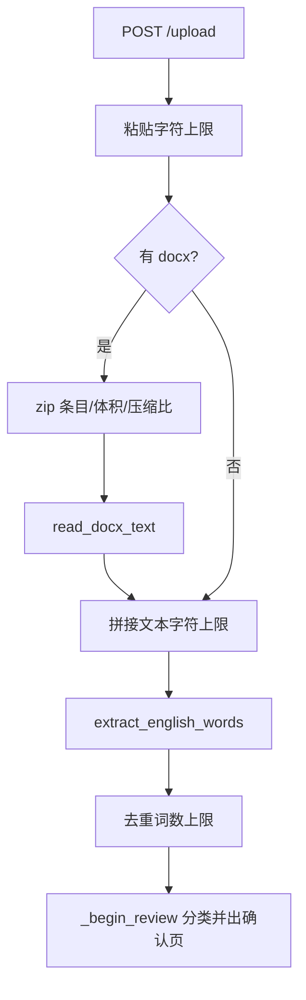

# SECURITY 1.3：资源耗尽防护

## 范围

- **做（实现留到下一轮）**
  - `/upload`：粘贴字符上限；docx 抽出文本上限；去重后词数上限；超限中文友好拒绝，且在渲染确认页之前拦住。
  - `.docx`：打开前检查 zip 条目数、声明的解压体积、压缩比；畸形包走现有「无法读取文档」。
  - `/api/parse_wordlist`：保持 1MB / 20 万词；算法扩充加词数门槛 + 循环内时间预算，超时/超限直接拒绝。不做后台队列。
  - `GET /healthz`：只表示进程在听，不调用 `load_ecdict_headwords`，不扫 `.cache`。
- **只写文档、不登录服务器**：Nginx `limit_req` 示例写入 `.github/DEPLOY.md`；HANDOFF 注明需手动改。
- **不做**：后台队列 / Redis；收紧 `deploy.yml` 分支（属 1.2）；`user_data` 体积（属 2.2）；CSRF / CSP；改确认页勾选默认、着色与释义表两套逻辑、设置页 JSON 的 `\u003c` 规则。

## 现状锚点

- 整包上限已有：`word_retrieval/__init__.py` `MAX_CONTENT_LENGTH = 16MB`。粘贴框 `index.html` 的 `textarea#article` **无** `maxlength`。
- `word_retrieval/routes.py` `upload()`：`article` 原样进入 `_begin_review`；`read_docx_text` 之后无文本长度/词数检查。`ValueError` 与 `BadZipFile` 被合成同一句「无法读取文档」，上限错误必须分开返回。
- `word_retrieval/extractor.py` `read_docx_text`：`Document(BytesIO)` 直接打开，无解压比/条目检查。
- 确认页 `word_retrieval/pages/confirm.py`：每个词一块 HTML，黄词还带整组词典表单。词数必须在 `render_confirm_page` 之前拒绝。
- 对照表：`word_retrieval/lexicon.py` `MAX_UPLOAD_BYTES = 1MB`、`MAX_UPLOAD_WORDS = 200_000`，保持。
- 派生词：`word_retrieval/inflections.py` `expand_wordlist_forms` / `expand_with_inflections` 同步跑 lemminflect；`pick` 会 `load_ecdict_headwords`。开发机是 Windows，**不能用** `signal.alarm`，只在循环里看 `time.monotonic()`。
- 词头：`word_retrieval/ecdict.py` `load_ecdict_headwords` 冷启动扫全表。`create_app()` 本身不加载词头。

## 建议阈值（实现时放进 `app.config`，与现有 `CACHE_MAX_*` 并列）

- `MAX_ARTICLE_CHARS = 200_000`：仅粘贴 `article`（`strip` 后按字符数）。
- `MAX_SOURCE_TEXT_CHARS = 500_000`：docx 抽出文本与粘贴拼接后的总字符数（`extract_english_words` 之前）。
- `MAX_EXTRACTED_WORDS = 5_000`：去重后的词数（绿+黄+红之前，确认页之前）。
- docx：`MAX_DOCX_ENTRIES = 2_000`；`MAX_DOCX_UNCOMPRESSED = 64MB`（单条与合计都看 `ZipInfo.file_size`）；`MAX_DOCX_RATIO = 100`（`compress_size == 0` 时不除，只看声明体积）。
- 派生词：`algo_mode` 为 `all` 或 `pick` 时，基础词数 `> 20_000` 直接拒绝。`expand_with_inflections` 与 exchange 查询循环共用 **20 秒**预算，超时 `ValueError`。`algo_mode=none` 且不开 exchange 时不加这道门槛。1MB / 20 万词上限不动。

## 请求路径

`/api/parse_wordlist`：现有解码与 20 万词校验之后，若要跑算法或 exchange，先看词数门槛，再在 `expand_wordlist_forms` 内按时间预算中断。`GET /healthz` 不进入上述路径。

## 实现要点

1. **docx 预检**放在 `extractor.py`：`assert_docx_package(file_bytes)` 用标准库 `zipfile`，失败抛 `ValueError`（中文原因）。通过后再 `Document(...)`。随机 zip / 坏包仍由现有 `BadZipFile` / `PackageNotFoundError` 分支处理。
2. **`routes.py` `upload()`**：粘贴超限、拼接文本超限、词数超限各自 `render_message_page`，文案带上限数字。不要塞进「无法读取文档」。词数检查放在 `extract_english_words` 之后、`_begin_review` 之内或紧前，保证不写 session、不渲染确认页。
3. **首页**：`index.html` 给 `#article` 加 `maxlength="200000"`，并加一句上限说明。服务端仍是准绳。
4. **派生词**：`inflections.py` 增加可选 `deadline`；`routes.py` `api_parse_wordlist` 在调用前拒绝超 2 万词的算法请求。超时/超限走现有 `ValueError` → JSON `error`。线程池超时不可用：Python 停不掉已在跑的线程，超时后 CPU 仍会打满。
5. **`/healthz`**：`routes.py` 增加 `GET /healthz`，`jsonify({"ok": true})`，状态 200。不打开 SQLite、不 `cleanup_expired`。
6. **Nginx（仅文档）**：在 `.github/DEPLOY.md` 现有 `client_max_body_size 16m` 旁补 `limit_req_zone` 示例（全站较松，`/upload` 与 `/api/parse_wordlist` 更严），并写明须在服务器上手动 `nginx -t` 后 reload。本仓库不 SSH。
7. **真正改代码时再同步**：`README.md` 中英对应段（粘贴/词数上限、`/healthz`）、`HANDOFF.md`、`SECURITY_STABILITY.md` 1.3 状态与修订记录、必要时 `privacy.py` 与 `python build_readme_docx.py`。`SECURITY_STABILITY.md` 与 `HANDOFF.md` 仍不提交。

## 明确不改

- 确认页勾选默认、着色与释义表独立、黄词中文释义必填、写回只进浏览器 `user_data`。
- 对照表 1MB / 20 万词。
- 设置页 `<script type="application/json">` 只把 `<` 换成 `\u003c`。
- 不把 ECDICT 全词灌进对照表；`/healthz` 不触发全词头加载。

## 验收（实现那一轮）

- 纯粘贴超过 20 万字：确认页不出现，页面提示过长。
- 去重词超过 5000：不写 `.cache/sessions`，不返回巨型确认 HTML。
- 声明解压体积或压缩比超限的 zip：快速 `ValueError`，不调用 `Document`。
- 普通短文 `.docx` + 粘贴仍能分类、确认、下载。
- `algo_mode=all` 且基础词超过 2 万：JSON 400，不跑 lemminflect。预算内的小词表行为与现在一致。
- `GET /healthz` 在未请求过 `/upload` 时也为 200，且不调用 `load_ecdict_headwords`。
- DEPLOY 含 `limit_req` 示例；线上 Nginx 未改，直到手动执行。

## 落地记录

- 日期：2026-11-15
- 状态：已实现（应用层上限 + `/healthz` + 文档；线上 Nginx `limit_req` 须按 DEPLOY 手动执行）
