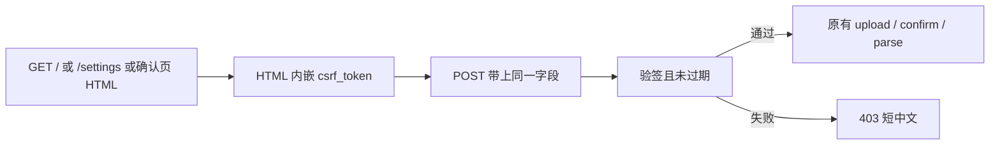
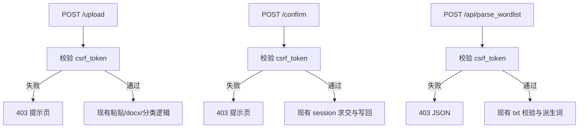

# SECURITY 2.1：CSRF 防护

## 范围

- **做（已实现）**
  - 为三个 POST 入口加无状态 HMAC 表单令牌：`/upload`、`/confirm`、`/api/parse_wordlist`。
  - GET 页面（首页 / 确认页 / 设置页）签发并内嵌 `csrf_token`；POST 先验签再进业务逻辑。
  - 新模块 `word_retrieval/csrf.py`：密钥确保、签发、校验；`create_app()` 启动时确保密钥可用。
- **不做**
  - Flask-WTF / 服务端 Flask session / cookie 存令牌。
  - 单靠 `Origin` / `Referer` 校验（可作日后补充，本轮不以它为准）。
  - 2.2 `user_data` 体积上限；2.3 CSP / 安全响应头；1.2 收紧 `deploy.yml` 分支。
  - 改确认页勾选默认、着色与释义表两套逻辑、设置页 JSON 的 `\u003c` 规则。

## 现状锚点

- 无账号体系；网页用户差分在浏览器 localStorage；服务端不把用户差分写入共享 `wordlists/` / `ecdict.db` / `dict_extra|exclude`。
- 三个 POST 均无 CSRF token，也无 `Origin`/`Referer` 检查：
  - `POST /upload`：`index.html` `#uploadForm` → `routes.py` `upload()`；提交前 `UserDataStore.attachHiddenField` 写入 `user_data`。
  - `POST /confirm`：`pages/confirm.py` 表单（隐藏域 `session_id`）→ `routes.py` `confirm()`；勾选与 session 内 green/yellow/red **求交**。
  - `POST /api/parse_wordlist`：`pages/settings.py` `fetch(PARSE_API, { method: "POST", body: fd })` → JSON 响应；结果由前端写入本机对照表。
- 本站主流程**不依赖** Flask session cookie；跨站表单导航仍可代发 POST（`SameSite` 帮不上忙）。
- GET：`/`、`/settings`、`/privacy`、`/healthz`、`/download/<token>` 不需要 CSRF。
- `_render_index()` 已用占位符替换（`<!--WORDLIST_OPTIONS-->`、`<!--BASELINE_WORDLISTS_JSON-->`），可同样注入令牌。
- 设置页 script 内 JSON：**不要** `html.escape`；只把 `<` 换成 `\u003c`（与 baseline JSON 同一规则）。

## 为何选 HMAC 令牌

| 方案 | 结论 |
|------|------|
| 仅 `Origin`/`Referer` | 部分客户端不送 `Origin`；日后 2.3 `Referrer-Policy` 可能拿掉 `Referer`；单独不够稳 |
| Flask-WTF / cookie session | 当前无登录 session；引入 cookie 面更大，多 worker 还要配 `SECRET_KEY` 与 cookie 策略 |
| **页面内嵌 HMAC 令牌** | 跨站读不到本站 HTML（同源 + 未开 CORS）；不放 cookie/localStorage；多 worker 只共享密钥文件 |

危害回顾（无防护时）：

- `/upload`：跨站代提交可占会话/缓存配额；伪造 `user_data` 进入确认页后，若用户点确认，结果页 `applyServerPayload` 可能覆盖本机 localStorage。
- `/confirm`：需合法 `session_id`，单独 CSRF 较难，可与伪造 upload 链路配合。
- `/api/parse_wordlist`：即便读不到 JSON，跨站 POST 仍可空耗 ECDICT / 算法扩充。

## 令牌设计

- **字段名**：`csrf_token`（表单隐藏域 / `FormData`）。
- **格式**：`{expiry}.{mac}`  
  - `expiry`：Unix 秒（十进制）。  
  - `mac`：`HMAC-SHA256(secret, expiry)` 的 hex（小写）。  
  - 验签用 `hmac.compare_digest`；过期则失败。
- **有效期**：`CSRF_TOKEN_MAX_AGE_SEC = 7200`（2 小时）。确认会话 TTL 约 30 分钟，2 小时覆盖「打开首页后在确认页停留」的常见路径。
- **密钥**（优先级）：
  1. 环境变量 `WR_CSRF_SECRET`（非空字符串）；
  2. 否则文件 `.cache/csrf_secret`（已在 `.gitignore` 的 `.cache/` 下）：不存在则生成 32 字节随机 hex 并写入；多 gunicorn worker 读同一文件。
- **配置**：`create_app()` 调用 `ensure_csrf_secret(...)`，把解析后的 secret 放进 `app.config["CSRF_SECRET"]`；可选 `app.config["CSRF_TOKEN_MAX_AGE_SEC"] = 7200`。
- **保密**：密钥不进仓库、不进错误页、不进对外日志；失败文案不区分缺字段 / 过期 / 篡改。
- **失败文案（统一）**：「请求未通过安全校验，请从本站页面重新提交。」  
  - `/upload`、`/confirm` → `render_message_page(..., status=403)`  
  - `/api/parse_wordlist` → `jsonify({"ok": false, "error": ...}), 403`  
  - 校验放在读上传正文 / 建 session / 跑派生词**之前**。

## 请求路径

## 实现要点（下一轮改代码时按此做）

1. **`word_retrieval/csrf.py`**（新建）  
   - `ensure_csrf_secret(path, env_value=None) -> str`  
   - `issue_csrf_token(secret, *, max_age_sec=7200) -> str`  
   - `validate_csrf_token(secret, token, *, max_age_sec=7200) -> bool`  
   - 无 Flask 依赖亦可，便于单测；路由层从 `current_app.config` 取 secret。

2. **`word_retrieval/__init__.py` `create_app()`**  
   - 在 `ensure_cache_dirs` 之后（或并列）确保 `.cache/csrf_secret`；设置 `CSRF_SECRET`、`CSRF_TOKEN_MAX_AGE_SEC`。

3. **`routes.py`**  
   - 小工具 `_require_csrf()`：读 `request.form.get("csrf_token")`，失败返回 403 响应对象；成功返回 `None`。  
   - `upload()`、`confirm()`、`api_parse_wordlist()` 函数开头调用；失败则立刻 return。  
   - `_render_index()`：`issue_csrf_token` 后替换 `<!--CSRF_TOKEN-->`。  
   - `_begin_review` → `render_confirm_page(..., csrf_token=...)` 签发新令牌（确认页停留期间用确认页上的令牌，不必与首页同一串）。

4. **`index.html`**  
   - `#uploadForm` 内增加：  
     `<input type="hidden" name="csrf_token" value="<!--CSRF_TOKEN-->" />`  
   - 直接 `file://` 打开时表单本就禁用，行为不变。

5. **`pages/confirm.py`**  
   - `render_confirm_page` 增加参数 `csrf_token: str`；在 `session_id` 旁加隐藏域 `name="csrf_token"`（值做 `html.escape`，令牌为 hex/数字点号，无特殊字符风险，escape 无害）。

6. **`pages/settings.py`**  
   - `render_settings_page(..., csrf_token: str)`；页面脚本增加  
     `const CSRF_TOKEN = {json.dumps(csrf_token)};`  
     （`json.dumps` 即可；勿 `html.escape`。）  
   - `btnUpload` 的 `FormData`：`fd.append("csrf_token", CSRF_TOKEN)`。  
   - `routes.settings()` 签发令牌传入。

7. **真正改代码时再同步**  
   - `README.md` 中英各一句：状态改变写回与上传须从本站页面提交（含安全校验）。  
   - `HANDOFF.md`：CSRF 令牌、密钥位置、三个 POST。  
   - `SECURITY_STABILITY.md`：2.1 标为已落地 + 修订记录。  
   - 若隐私页需提及表单安全校验，改 `privacy.py`。  
   - 必要时 `python build_readme_docx.py`。  
   - `SECURITY_STABILITY.md` 与 `HANDOFF.md` **仍不提交**。

## 明确不改

- 确认页勾选默认、着色与释义表独立、黄词中文释义必填、写回只进浏览器 `user_data`。
- 设置页 `<script type="application/json">` 只把 `<` 换成 `\u003c`。
- 不引入 Flask-WTF；不把令牌写入 localStorage。
- 不把 ECDICT 全词灌进对照表；不写共享对照表/词典文件。
- GET `/healthz`、一次性下载链接逻辑不动。

## 验收（实现那一轮）

- 本站打开首页 → 粘贴/上传 → 确认 → 下载：全流程成功。
- 设置页上传合法 `.txt`（含/不含派生词选项）：成功并写入本机。
- 不带 `csrf_token`、空令牌、篡改 mac、过期 expiry 的 `POST /upload`：403 提示页，**不**写 `.cache/sessions`。
- 同上对 `POST /confirm`：403，不生成下载。
- 同上对 `POST /api/parse_wordlist`：403 JSON，`ok: false`，不跑 lemminflect。
- `GET /healthz` 仍为 200；下载链接行为与一次性删除不变。
- 多 worker（`-w 2`）下首页签发的令牌可被另一 worker 的 POST 接受（共享 `.cache/csrf_secret` 或同一环境变量）。

## 落地记录

- 日期：2026-11-20
- 状态：已实现（`csrf.py` + 三 POST 校验 + 首页/确认/设置注入；README / HANDOFF / SECURITY / privacy / README.docx 已同步）。
