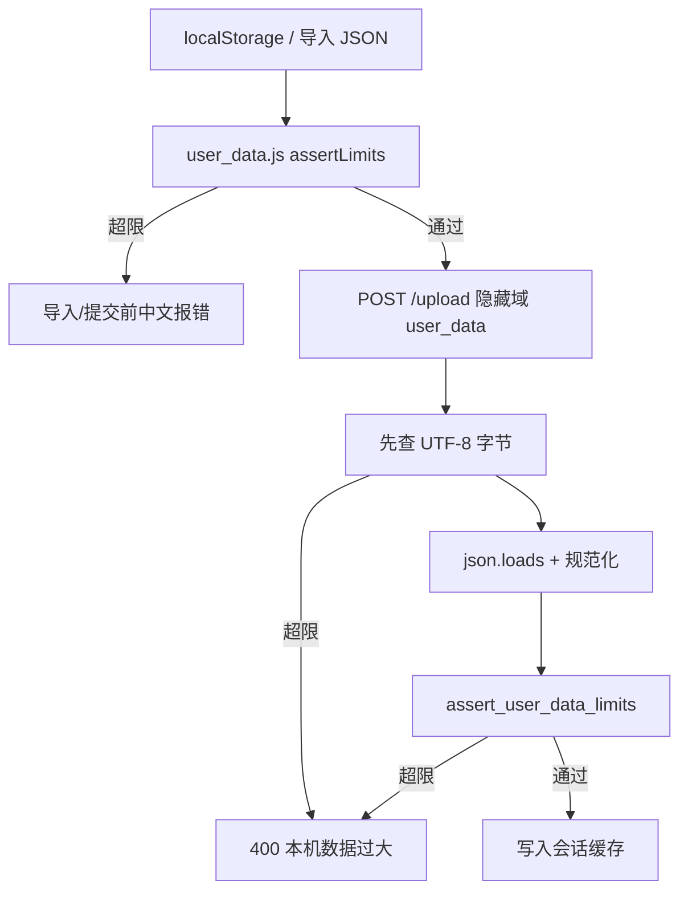

# SECURITY 2.2：`user_data` 体量与信任边界

## 范围

- **做（已实现）**
  - 服务端 `parse_user_data`：原始 JSON 字节 / 表数量 / 词条数 / 词条字段长度上限；超限 **拒绝**（`ValueError`），不截断。
  - `POST /upload` 捕获该错误 → 400 友好提示页；不建会话。
  - 前端 `user_data.js` 同等常量与 `assertLimits`：设置页导入、`save` / `replaceAll`、首页提交前校验。
- **不做**
  - 截断超限数据；2.3 CSP / 安全响应头；1.2 收紧 `deploy.yml` 分支。
  - 改确认页勾选默认、着色与释义表两套逻辑、设置页 JSON 的 `\u003c` 规则。
  - 把用户差分写回服务器共享 `wordlists/` / `ecdict.db` / `dict_extra|exclude`。

## 现状锚点（改之前）

- `POST /upload` 隐藏域 `user_data` → `parse_user_data`：非法 JSON 返回空结构，**无体量上限**。
- 解析结果进会话磁盘缓存；结果页整包 JSON 进 `<script>`（`<` → `\u003c`）。
- 设置页导入仅浏览器 `UserDataStore.replaceAll`，服务端不校验；下次上传仍整包打到服务器。
- 恶意可绕过 localStorage，在 `MAX_CONTENT_LENGTH`（16MB）内塞巨大 JSON。

## 上限表

| 项 | 常量 | 值 |
|---|---|---|
| 原始 JSON 字节 | `MAX_USER_DATA_BYTES` | 1 MiB |
| 自建表数量 | `MAX_CUSTOM_LISTS` | 50 |
| 差分表数量 | `MAX_PATCHES` | 50 |
| 单自建表词数 / 单差分 add+remove 合计 | `MAX_WORDS_PER_LIST` | 50_000 |
| `dict_extra` 条数 | `MAX_DICT_EXTRA` | 10_000 |
| `dict_exclude` 词数 | `MAX_DICT_EXCLUDE` | 10_000 |
| 词条字段 | `MAX_ENTRY_*` | word 64；phonetic/pos 128；definition/translation 2000；exchange 512 |

非法 JSON / 非对象 → 仍返回空结构。仅体量/schema 超限 → 拒绝。

说明：对照表上传 API 仍允许 txt 约 20 万词；写入本机自建表时受 **5 万词/表** 限制，超限在前端 `save` 拒绝。

## 请求路径

## 实现要点

1. **`word_retrieval/user_data.py`**  
   - 模块常量；`_assert_entry_field_lengths`；`assert_user_data_limits`；  
   - `normalize_dict_extra(..., strict=True)` 字段超长向上抛；  
   - `parse_user_data`：字节检查 → 解析 → `strict` 规范化 → `assert_user_data_limits`。

2. **`word_retrieval/__init__.py`**  
   - `app.config` 镜像上述上限（与 1.3 风格一致）。

3. **`routes.py` `upload()`**  
   - `try/except ValueError` → `render_message_page("本机数据过大", ..., status=400)`，在读 docx / 建会话之前。

4. **`static/user_data.js`**  
   - 同等常量、`assertLimits`、`buildPayload`；`save`/`replaceAll`/`attachHiddenField` 提交路径校验；`?v=6`。

5. **设置页导入**  
   - 先查文件 UTF-8 字节，再 `replaceAll`（内部再验）。

6. **文档**  
   - `README.md` / `HANDOFF.md` / `SECURITY_STABILITY.md` / 隐私页；`python build_readme_docx.py`。

## 明确不改

- 确认页勾选默认与写回；着色与释义表独立。
- 结果页 / 设置页 script 内 JSON：只把 `<` 换成 `\u003c`，勿 `html.escape`。
- `/confirm` 使用会话内已解析数据，不再验整包（上传已拦）。

## 验收

- 正常小包：上传 / 确认 / 设置导入导出不变。
- 超 1MiB 或超表数/词数：上传 400；设置导入失败；不建会话。
- 结果页 script 仍只用 `\u003c`。

## 落地记录

- 日期：2026-11-20
- 状态：已实现（服务端拒绝 + 前端导入/提交校验；README / HANDOFF / SECURITY / privacy / plan 备份 / README.docx 已同步）。
