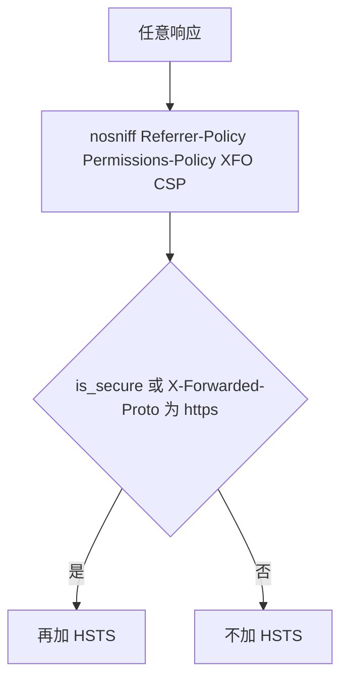

# SECURITY 2.3：安全响应头

## 范围

- **做（已实现）**
  - Flask `after_request` 为全部响应附加常用安全头 + 宽松 CSP。
  - 仅 HTTPS（`request.is_secure` 或 `X-Forwarded-Proto` 首值为 `https`）时附加 HSTS。
  - 新模块 `word_retrieval/security_headers.py`；`create_app()` 注册。
- **不做**
  - 导出 JSON 签名/校验和；外置内联 JS/CSS；去掉 CSP 的 `'unsafe-inline'`。
  - Nginx `add_header`、改 `deploy.yml`、引入 `ProxyFix`。
  - CSP `upgrade-insecure-requests`（会破坏本地 `http://127.0.0.1:5000`）。
  - 改确认页勾选默认、着色与释义表逻辑、设置页 JSON 的 `\u003c` 规则。

## 现状锚点（改之前）

- 无 CSP / `X-Content-Type-Options` / `Referrer-Policy` / `Permissions-Policy` / `X-Frame-Options` / HSTS。
- 各页大量内联 `<style>` / `<script>`；外置 JS 主要是 `/static/user_data.js`；备案图同源。
- CSRF 已用 HMAC 表单令牌，不依赖 `Referer`。
- Nginx 反代示例已有 `X-Forwarded-Proto $scheme`（DEPLOY 第七节）；Actions 不改 Nginx。

## 响应头表

| 头 | 值 |
|---|---|
| `X-Content-Type-Options` | `nosniff` |
| `Referrer-Policy` | `strict-origin-when-cross-origin` |
| `Permissions-Policy` | `camera=(), microphone=(), geolocation=()` |
| `X-Frame-Options` | `DENY` |
| `Content-Security-Policy` | 见下（宽松） |
| `Strict-Transport-Security` | `max-age=15552000`（仅 HTTPS；无 `includeSubDomains` / preload） |

CSP：

```text
default-src 'self'; script-src 'self' 'unsafe-inline'; style-src 'self' 'unsafe-inline'; img-src 'self'; font-src 'self'; connect-src 'self'; form-action 'self'; base-uri 'self'; frame-ancestors 'none'; object-src 'none'
```

## HSTS 判定



- 本地直连 `app.py`：无 HSTS。
- 生产：依赖 Nginx 已传 `X-Forwarded-Proto`；未传则其余头仍在、无 HSTS。

## 实现要点

1. **`word_retrieval/security_headers.py`**  
   - `request_is_https(req)`、`apply_security_headers(resp, req=None)`、`register_security_headers(app)`。
2. **`word_retrieval/__init__.py`**  
   - `register_blueprint` 之后调用 `register_security_headers(app)`。
3. **文档**  
   - README 中英、HANDOFF、SECURITY_STABILITY §2.3、privacy 各补一句；`build_readme_docx.py`。

## 明确不改

- 确认页勾选默认与写回；着色与释义表两套逻辑独立。
- 设置页 `<script type="application/json">` 只把 `<` 换成 `\u003c`。
- 不把用户差分写共享 `wordlists/` / `ecdict.db` / `dict_extra|exclude`。
- `SECURITY_STABILITY.md` 与 `HANDOFF.md` **仍不提交**。

## 验收

- `curl -I http://127.0.0.1:5000/` 与 `/healthz`：有常见头 + CSP，**无** HSTS。
- 同请求加 `X-Forwarded-Proto: https`：**有** HSTS。
- 首页 / 设置页 / 确认页内联脚本仍可用；控制台无 CSP 拦截。

## 落地记录

- 日期：2026-11-20
- 状态：已实现（`security_headers.py` + `after_request`；README / HANDOFF / SECURITY / privacy / README.docx 已同步；Cursor 计划备份见 `plan/security_stability/07-security-headers.plan.md`）。
