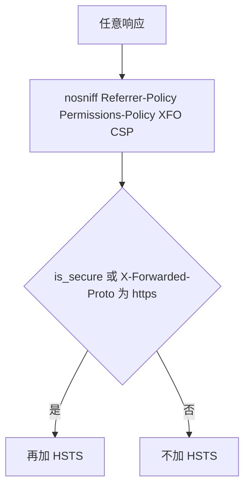

# SECURITY 2.3：安全响应头

已确认：只做安全头；加在 Flask `after_request`（不改 Nginx / 不改 `DEPLOY.md`）；CSP 允许现有内联 script/style；HSTS 要加，但本地纯 HTTP 不发。

## 范围

- **做**
  - 新模块 [`word_retrieval/security_headers.py`](word_retrieval/security_headers.py)，在 [`word_retrieval/__init__.py`](word_retrieval/__init__.py) 的 `create_app()` 注册 `after_request`，覆盖 HTML、JSON、`/static`、下载 docx。
  - 每条响应：
    - `X-Content-Type-Options: nosniff`
    - `Referrer-Policy: strict-origin-when-cross-origin`（不依赖 Referer 做 CSRF；外链备案已有 `rel="noreferrer"`）
    - `Permissions-Policy: camera=(), microphone=(), geolocation=()`
    - `X-Frame-Options: DENY`
    - `Content-Security-Policy`（宽松，匹配现状：内联样式/脚本 + 同源 `/static/user_data.js` 与备案图标，无外站脚本/字体）
  - **仅 HTTPS 时**加 `Strict-Transport-Security: max-age=15552000`（约 180 天；不加 `includeSubDomains`、不 preload）。
- **不做**
  - 导出 JSON 签名/校验和；外置现有内联 JS/CSS；收紧到去掉 `'unsafe-inline'`。
  - Nginx `add_header`、改 [`deploy.yml`](.github/workflows/deploy.yml)、`ProxyFix`（避免改 `remote_addr` / URL 生成）。
  - `upgrade-insecure-requests`（本地 `http://127.0.0.1:5000` 会被升级到 HTTPS 而打不开）。
  - 确认页勾选默认、着色/释义表逻辑、script JSON 的 `\u003c` 规则。

## HSTS 判定

gunicorn 在 Nginx 后面看到的是 HTTP，`request.is_secure` 在线上为假。判定为 HTTPS 当且仅当：

- `request.is_secure`，或
- `X-Forwarded-Proto` 第一个值（逗号分隔）为 `https`

[`DEPLOY.md`](.github/DEPLOY.md) 第七节示例里已有 `proxy_set_header X-Forwarded-Proto $scheme`。本轮不改该文件。若线上 Nginx 没传这个头，公网仍有其余安全头，但**没有 HSTS**；本地直连 `app.py` 不带该头，因此不发 HSTS。

## CSP（不拆内联）

单行策略，约：

`default-src 'self'; script-src 'self' 'unsafe-inline'; style-src 'self' 'unsafe-inline'; img-src 'self'; font-src 'self'; connect-src 'self'; form-action 'self'; base-uri 'self'; frame-ancestors 'none'; object-src 'none'`

页面只有同源脚本 [`word_retrieval/static/user_data.js`](word_retrieval/static/user_data.js)、同源备案图、各页 `<style>` / `<script>` 与 `style=""`。设置页 `fetch` 打本站 `/api/parse_wordlist`。无 CDN。

## 文档（同一任务内）

- 方案 [`plan/security_stability/07-security-headers.md`](plan/security_stability/07-security-headers.md)（与 05/06 同结构：范围、头表、HSTS 条件）。
- [`SECURITY_STABILITY.md`](SECURITY_STABILITY.md) §2.3 标完成 + 修订记录（不提交）。
- [`HANDOFF.md`](HANDOFF.md) 补一句：安全头在应用层；HSTS 依赖已有 `X-Forwarded-Proto`（不提交）。
- [`README.md`](README.md) 中英隐私/流程段各加一句安全响应头；再 `python build_readme_docx.py`。
- [`word_retrieval/pages/privacy.py`](word_retrieval/pages/privacy.py) 在 HTTPS 段补一句：响应带浏览器安全头；HTTPS 下另有 HSTS。不提导出完整性。

## 验收

- `curl -I http://127.0.0.1:5000/` 与 `/healthz`：有上述头，**无** `Strict-Transport-Security`。
- 带 `X-Forwarded-Proto: https` 的同一请求：**有** HSTS。
- 浏览器走首页 → 设置（内联脚本、导入按钮仍可用）→ 确认页勾选区仍可点；控制台无 CSP 拦截。
