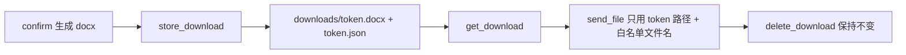

# 2.4 下载硬化

## 范围

做两件事，不改「首次下载后删除」和 TTL：

- **路径**：`GET /download/<token>` 只读 `.cache/downloads/{token}.docx`，忽略 meta JSON 里的 `path`。
- **文件名**：写入和读出时都把 `download_name` 收成安全的 `*.docx`；洗不出来则用 `document.docx`。

不做：账号绑定、签名 token、改 Nginx、改 CSRF、改确认页勾选。

## 现状

[`word_retrieval/routes.py`](word_retrieval/routes.py) 的 `download_file` 已校验 token（`^[0-9a-f]{32}$`），读入内存后 `delete_download`。缺口在：

```728:753:word_retrieval/routes.py
    path = Path(meta["path"])
    ...
    download_name = meta["download_name"]
    ...
    return send_file(..., download_name=download_name, ...)
```

[`word_retrieval/job_cache.py`](word_retrieval/job_cache.py) 的 `get_download` 把 meta.`path` 原样返回；`store_download` 把 `download_name` 原样写入。正常流程的文件名来自 `_safe_stem`（`{stem}_highlighted.docx` / `{stem}_unknown_vocab.docx`），但下载响应不再校验。



## 实现

1. 在 [`word_retrieval/job_cache.py`](word_retrieval/job_cache.py) 增加 `safe_download_name(name) -> str`：
   - 只取 basename，去掉目录。
   - 后缀必须是 `.docx`（大小写不敏感），否则 `document.docx`。
   - 词干复用与 `_safe_stem` 相同的规则：`[^\w\-]` 换成 `_`，去掉首尾 `_`；空则 `document`。
   - 词干长度帽约 80，避免超长 `Content-Disposition`。
   - 拼回 `{stem}.docx`。
2. `store_download` 写入前先 `safe_download_name`。`get_download` 返回的 `download_name` 再洗一次（防已落盘或被改过的 JSON）；`path` 固定为 `download_dir / "{token}.docx"`，不再读 meta.`path`。
3. [`word_retrieval/routes.py`](word_retrieval/routes.py) `download_file` 用返回的规范路径，并 `resolve()` 后确认仍在 `download_dir` 内再 `read_bytes`。`send_file` 使用洗过的文件名。删除顺序不变：读入内存 → `delete_download` → 发送。
4. 生成侧文件名（`_safe_stem` + `_highlighted` / `_unknown_vocab`）不用改规则；经 `safe_download_name` 后与现在正常上传的文件名一致。

## 文档

同一任务内更新（行为说明，用户正常下载文件名不变）：

- 新建 [`plan/security_stability/08-download-hardening.md`](plan/security_stability/08-download-hardening.md)（范围 / 不做 / 验收）。
- [`SECURITY_STABILITY.md`](SECURITY_STABILITY.md) §2.4 标为已完成，并加修订记录。
- [`HANDOFF.md`](HANDOFF.md) 下载缓存一段补上：路径只按 token、文件名白名单。
- [`README.md`](README.md) 流程段现有「一次有效」旁加半句（中英对应），再跑 `python build_readme_docx.py`。

## 验收

仓库没有 pytest。用本地 Python 直接调函数核对：

- `../x.docx`、`a/b.docx`、带引号或换行的名字 → `document.docx` 或仅含词字符的 `*.docx`。
- 正常 `笔记_highlighted.docx` 保持可读。
- meta 里 `path` 指向目录外时，`get_download` 仍指向 `{token}.docx`。
- 合法 token 第二次请求仍是「已过期或已下载」。
