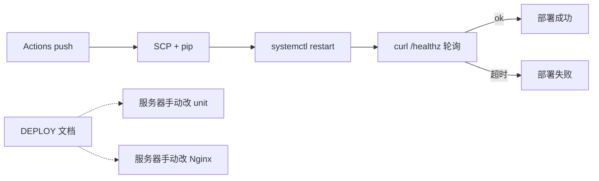

# 3.1 健康检查与优雅重启

## 范围

- **做**
  - 保持已有 `GET /healthz`：`{"ok": true}`，不加载 ECDICT、不扫 `.cache`（1.3 轻量约定不变）。
  - `.github/DEPLOY.md`：systemd 示例补 `TimeoutStopSec` / `KillMode`、gunicorn `--graceful-timeout` / `--timeout`；Nginx 示例改用 `upstream` + 短 `proxy_connect_timeout` + `proxy_next_upstream`（须服务器手动改，Actions 不改 Nginx/unit）。
  - `.github/workflows/deploy.yml`：`systemctl restart` 后轮询本机 `http://127.0.0.1:5000/healthz`，超时失败退出。
- **不做**
  - 不新增 `/readyz` / ECDICT 预热检查。
  - 不改应用业务逻辑、确认页勾选、CSP、CSRF。
  - Actions 不 SSH 改服务器上的 unit 或 Nginx 配置文件。

## 决策（用户确认）

1. 部署探活采用方案 **B**（Actions 轮询 `/healthz`），并与文档侧优雅重启互补。
2. `/healthz` **保持轻量**（不做 ECDICT readiness）。

## 现状

- [`word_retrieval/routes.py`](word_retrieval/routes.py) 已有轻量 `healthz`。
- ECDICT 在首次 `load_ecdict_headwords` 时惰性加载；启动瞬间 `connection refused` 多半是 gunicorn 尚未 bind，不是词典未就绪。
- DEPLOY 的 systemd / Nginx 示例无 graceful / upstream 重试；`deploy.yml` 重启后只 `status`，不探活。



## 实现

1. **DEPLOY.md §四**：`ExecStart` 示例加入 `--timeout 120 --graceful-timeout 30`；`TimeoutStopSec=60`、`KillMode=mixed`；注明手动 `daemon-reload` + `restart`。
2. **DEPLOY.md §七**：在限流示例旁增加 `upstream word_retrieval { server 127.0.0.1:5000; }`；`proxy_pass http://word_retrieval`；`proxy_connect_timeout 2s`；`proxy_read_timeout 120s`；`proxy_next_upstream error timeout http_502 http_503`；`proxy_next_upstream_tries 2`。写明单机单后端时重试帮助有限，主要缩短挂死；真正缩短 refused 靠尽快 bind + 优雅停。
3. **deploy.yml**：restart + status 之后：

   ```bash
   echo "==> 等待 /healthz"
   ok=0
   for i in $(seq 1 30); do
     if curl -sf http://127.0.0.1:5000/healthz | grep -q '"ok"'; then
       echo "healthz ok (attempt $i)"
       ok=1
       break
     fi
     sleep 1
   done
   if [ "$ok" != 1 ]; then
     echo "错误: /healthz 在 30s 内未就绪"
     exit 1
   fi
   ```

4. 文档同步：`SECURITY_STABILITY.md` §3.1 标完成 + 修订记录；`HANDOFF.md` 部署段；`README.md` 中英半句（探活 + 部署等待）；`python build_readme_docx.py`。

## 服务器手动操作（与以往一致）

见落地文档 [`09-healthz-graceful.md`](09-healthz-graceful.md) 与 `.github/DEPLOY.md`：改 unit → `daemon-reload` → `restart`；改 Nginx → `nginx -t` → `reload`。

## 验收

- 本地 / 线上：`curl -s http://127.0.0.1:5000/healthz` → `{"ok":true}`，且不触发 ECDICT 全词头加载。
- 推代码后 Actions：restart 后日志出现 `healthz ok`；若故意停服务应部署失败。
- 服务器按 DEPLOY 改 unit/Nginx 后，`systemctl restart` 窗口内少硬杀、短连失败可再试一次。
