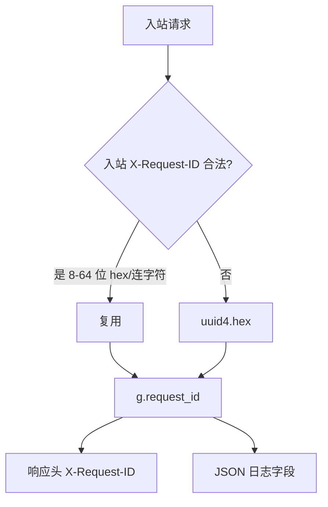

# SECURITY 3.2：可观测性

## 范围

- **做（已实现）**
  - Flask 应用层 **JSON 一行一条**日志（stderr，经 gunicorn 进 journald）。
  - 每请求 `request_id`（优先采信合法入站 `X-Request-ID`，否则新生成）；响应头回写 **`X-Request-ID`**；日志字段带同 id。
  - 替换 `_begin_review` 裸 `print` 为结构化 `logger.info`（来源标签、对照表名、绿/黄/红计数；不含正文）。
  - CSRF 失败 → `WARNING`；`CacheLimitError` → `WARNING`；意外异常 / `EcdictError` → `logger.exception`（`ERROR`+栈）。
  - `GET /healthz` **不打 INFO** 访问日志（探活不刷屏）。
- **不做**
  - 远程采集、改 Nginx / gunicorn access_log、文件落盘日志。
  - 记录粘贴正文、`user_data` 全文、CSRF 密钥。
  - `job_cache` 静默 `OSError` 补日志（未选范围 C）。
  - 改确认页勾选、着色/释义表、CSP、下载路径逻辑。

## 决策（用户确认）

1. 范围 **A**。
2. 回写 **`X-Request-ID`**。
3. **JSON 一行一条**。
4. 隐私元数据边界同意。
5. **`/healthz` 保持静默**。

## 现状锚点（改之前）

- `_safe_public_message` 已脱敏对外文案；意外异常已 `logger.exception`。
- `_begin_review` 仍有裸 `print` 分类摘要。
- `create_app` 无统一 logging / request id；无 `X-Request-ID`。

## 日志字段约定

每条 JSON 至少含：

| 字段 | 说明 |
|------|------|
| `ts` | ISO8601 UTC |
| `level` | DEBUG/INFO/WARNING/ERROR |
| `logger` | logger 名 |
| `msg` | 短消息 |
| `request_id` | 有请求上下文时 |

请求结束（非 healthz）另含：`method`、`path`、`status`、`duration_ms`。  
分类摘要另含：`event=classify`、`source_label`、`wordlist`、`total`/`green`/`yellow`/`red`。  
**禁止**：article 正文、完整 `user_data`、密钥。

## `X-Request-ID`

合法：`^[0-9a-fA-F-]{8,64}$`（防日志注入 / 过长头）。

## 实现要点

1. **`word_retrieval/request_logging.py`**
   - `JsonFormatter`；`configure_logging()`；`register_request_logging(app)`（`before_request` / `after_request`）。
   - `/healthz`：仍设 `X-Request-ID`，不写 INFO 访问行。
2. **`word_retrieval/__init__.py`**
   - `register_security_headers` 旁注册 `register_request_logging`。
3. **`word_retrieval/routes.py`**
   - 去掉 print；分类摘要 `logger.info`；CSRF / `CacheLimitError` 打 `warning`（带 `request_id` 经 Filter/上下文）。
4. **文档**
   - `SECURITY_STABILITY.md` §3.2 + 修订记录；`HANDOFF.md`；`README.md` 中英；`privacy.py` 一句；`build_readme_docx.py`。

## 验收

- 上传一次：stderr 有 JSON 行，含 `request_id`、分类计数、请求结束 `status`/`duration_ms`；无正文。
- 响应头有 `X-Request-ID`，与日志一致。
- `curl /healthz` 不产生应用 INFO 访问日志；头仍可有 request id。
- 伪造 CSRF：WARNING 一行；意外异常：ERROR+栈，页面仍短文案。

## 落地记录

- 日期：2026-11-20
- 状态：已实现（应用侧 JSON 日志 + request id；journald 查看即可，不改 Nginx）
